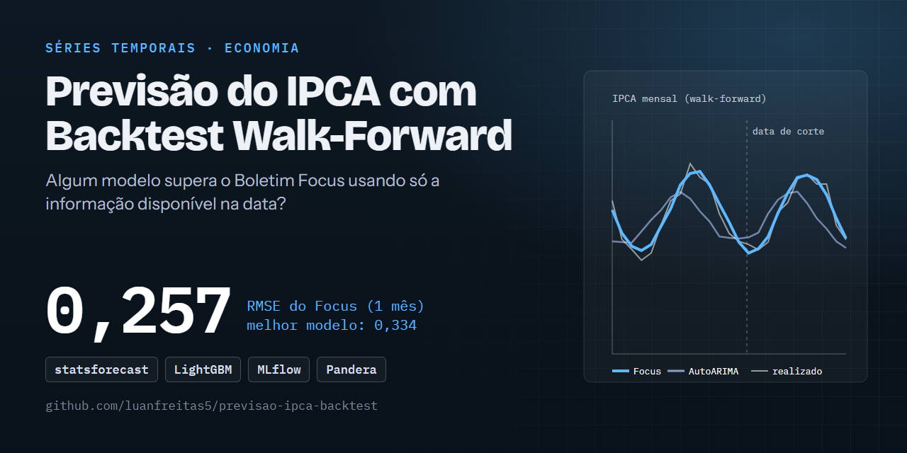

# 📈 Nenhum modelo supera o Boletim Focus na previsão do IPCA mensal (backtest walk-forward sem vazamento)

[](https://github.com/luanfreitas5/previsao-ipca-backtest/actions/workflows/ci.yml)
[](https://codecov.io/gh/luanfreitas5/previsao-ipca-backtest)
[](https://luanfreitas5.github.io/previsao-ipca-backtest/)
[](LICENSE)
 <!-- = matriz do tests.yml -->

> **Resultado:** o melhor modelo, **AutoARIMA**, atinge RMSE = **0,334 p.p. (IC 95%: 0,294–0,377)** no horizonte de 1 mês contra **0,412 (0,366–0,456)** do baseline ingênuo (último valor), em 200 origens mensais desde jan/2010. Mas o **Boletim Focus** tem **0,257 (0,220–0,293)** e vence com significância (Diebold-Mariano, p < 0,001); só em 6 e 12 meses o AutoARIMA empata estatisticamente com ele.



## 🎯 Problema

- **Quem decide o quê:** quem planeja custos, contratos ou reajustes precisa de uma previsão do IPCA dos próximos 1 a 12 meses. A pergunta é se um modelo estatístico ou de ML, usando **apenas informação pública disponível na data da previsão**, supera de forma significativa a mediana do Focus — e em quais horizontes e períodos ele perde.
- **Custo dos erros:** erros grandes em meses de choque são os mais custosos para o planejamento → **métrica principal: RMSE** (em pontos percentuais do IPCA mensal), com MAE como secundária. Não há custo assimétrico de falso positivo/negativo (regressão).
- **Unidade de predição e momento `t0`:** uma linha por (origem, horizonte). A origem é o fim de um mês e só entram observações com `available_at <= t0`. Avaliações costumam ser enganosas por usar a série na versão final, treinar com alvos ainda desconhecidos ou comparar modelos em amostras diferentes; aqui o vazamento é tratado como requisito, com [testes automatizados](tests/test_leakage.py).

## 🗂️ Dados

| Item | Valor |
|---|---|
| Fonte e licença | BCB/SGS e BCB/Olinda (Focus) — licença: a confirmar (ver Datasheets) |
| Tamanho / período | IPCA mensal desde 2000-01 (321 registros no snapshot de 2026-10-21); origens de backtest de 2010-01 em diante (≈ 200 por horizonte) |
| Alvo e prevalência | IPCA, variação mensal (%); regressão, sem prevalência |
| Documentação | [Datasheet SGS](reports/datasheets/bcb_sgs.md) · [Datasheet Focus](reports/datasheets/bcb_focus.md) |

| Fonte | Série | Código SGS | Uso | Atraso de divulgação assumido |
|---|---|---|---|---|
| BCB/SGS | IPCA, variação mensal (%) | 433 | alvo e lags | 10 dias após o fim do mês |
| BCB/SGS | IGP-M, variação mensal (%) | 189 | feature | 0 dia |
| BCB/SGS | Meta Selic (% a.a.) | 432 | feature (último valor do mês) | 0 dia |
| BCB/SGS | Dólar comercial (R$/US$) | 1 | feature (variação % da média mensal) | 0 dia |
| BCB/SGS | IBC-Br dessazonalizado | 24364 | feature (variação % mensal) | 50 dias |
| BCB/Olinda | Expectativas Focus (IPCA mensal) | — | baseline | snapshot + 3 dias |

Os dados brutos **não ficam no Git**: `make ingest` baixa e guarda snapshots datados e imutáveis em `data/bronze/<fonte>/<AAAA-MM-DD>/` com manifesto SHA-256 (idempotente no mesmo dia). Os atrasos ficam em [`configs/series.yaml`](configs/series.yaml). Camadas: `bronze` (como recebido) → `silver` (tipado, deduplicado, validado com pandera) → `gold` (ledger point-in-time, tabela supervisionada e previsões).

## 🧪 Método

1. **Features point-in-time.** Na origem `o`, só entram observações com `available_at <= o`. Os testes alteram valores futuros e exigem que as features não mudem.
2. **Modelos.** Ingênuo (último valor e sazonal), AutoARIMA e AutoETS (statsforecast, para ter baselines estatísticos clássicos) e LightGBM direto, um modelo por horizonte, com 12 lags de cada série (API nativa, sem scikit-learn).
3. **Backtest.** Janela expansiva, reajuste a cada origem, horizontes 1, 2, 3, 6 e 12. O treino só usa linhas cujo **alvo já havia sido divulgado**; `assert_no_leakage` barra o contexto que violar isso.
4. **Avaliação.** MAE e RMSE na amostra comum a todos os modelos e ao Focus, com IC 95% por bootstrap em blocos, fatias por subperíodo, piores erros e Diebold-Mariano (correção HLN) contra o Focus.
5. **Incerteza.** Intervalos conformais de 90% calibrados só com erros já observáveis.
6. **Experimentos.** MLflow (SQLite): run pai com configuração e tags `git_sha`, `git_dirty`, `data_hash` e `seed`; run filho por modelo com as mesmas tags.

## 📊 Resultados

Protocolo: origens mensais de jan/2010 em diante, janela expansiva, reajuste a cada origem, seed 42, amostra comum (n = 200 origens em h=1; 189 em h=12). RMSE em p.p. do IPCA mensal; IC 95% por **bootstrap em blocos** (1000 reamostragens). Os números vêm de [`reports/tables/metricas_por_horizonte.csv`](reports/tables/metricas_por_horizonte.csv) e do [relatório final](reports/relatorio_final.md), e dependem da data da coleta (o Focus e o IPCA mudam todo mês).

| Modelo | RMSE h=1 (IC 95%) | RMSE h=12 (IC 95%) | Razão ao Focus (h=1 / h=12) |
|---|---|---|---|
| **Focus** (referência) | **0,257 (0,220–0,293)** | **0,356 (0,267–0,443)** | 1,00 / 1,00 |
| AutoARIMA (melhor modelo) | 0,334 (0,294–0,377) | 0,371 (0,309–0,441) | 1,30 / 1,04 |
| LightGBM | 0,363 (0,316–0,409) | 0,424 (0,354–0,497) | 1,42 / 1,19 |
| AutoETS | 0,400 (0,349–0,446) | 0,466 (0,385–0,549) | 1,56 / 1,31 |
| Baseline: ingênuo (último valor) | 0,412 (0,366–0,456) | 0,482 (0,398–0,564) | 1,60 / 1,36 |
| Ingênuo sazonal | 0,438 (0,379–0,498) | 0,499 | 1,70 / 1,40 |

Razão > 1 = pior que o Focus. Tabela completa (h=2, 3 e 6, MAE e ICs) em [`reports/relatorio_final.md`](reports/relatorio_final.md).

### Significância (Diebold-Mariano contra o Focus)

| Modelo | h=1 | h=2 | h=3 | h=6 | h=12 |
|---|---|---|---|---|---|
| AutoARIMA (perda quadrática) | < 0,001 | 0,062 | 0,103 | 0,654 | 0,436 |
| AutoARIMA (perda absoluta) | < 0,001 | 0,023 | 0,023 | 0,272 | 0,219 |
| LightGBM (perda quadrática) | < 0,001 | 0,014 | 0,038 | 0,010 | 0,030 |

p-valores bilaterais. Ausência de significância com erros autocorrelacionados **não prova equivalência**.

### Principais achados

- **O Focus vence em todos os horizontes.** Em h=1 a diferença é significativa para todos os modelos. O Focus incorpora informação que as séries públicas usadas aqui não capturam.
- **O AutoARIMA é o melhor modelo e a vantagem do Focus encolhe com o horizonte:** a razão cai de 1,30 (h=1) para 1,02–1,07 (h=3 a 12). A diferença deixa de ser significativa em h=6 e h=12; em h=2 e h=3 depende da perda.
- **LightGBM, AutoETS e os ingênuos perdem de forma significativa em todos os horizontes.** O LightGBM não supera o AutoARIMA, apesar das features adicionais (IGP-M, Selic, câmbio, IBC-Br).
- **Choque de 2020–2022:** período de maior erro para todos. Em h=2 a 12 o AutoARIMA tem RMSE menor que o do Focus nesse período (h=6: 0,543 contra 0,585); em h=1 o Focus segue melhor. É descritivo, em 36 origens, sem teste de significância.
- **Pior segmento:** 2020–2022 (RMSE do AutoARIMA em h=1: 0,484 contra 0,264 em 2023+). Os maiores erros estão em jul/2022 (deflação de −0,68% após medidas sobre combustíveis, previsto ≈ +0,5 a +0,7) e mar/2022 (+1,62%): choques de política e de preços administrados que nenhum modelo univariado antecipa. Detalhes por fatia nos [Model Cards](reports/model_cards/autoarima_v0.1.0.md) ([LightGBM](reports/model_cards/lightgbm_v0.1.0.md)).
- **Cobertura conformal (nominal 90%) é insuficiente:** 0,77–0,89 conforme modelo e horizonte (AutoARIMA: 0,84 em h=1 e 0,80 em h=12), consistente com a violação da trocabilidade em períodos de choque.


Outras figuras: [previsto vs. realizado (h=1)](reports/figures/previsto_vs_realizado_h1.png), [(h=12)](reports/figures/previsto_vs_realizado_h12.png) e [cobertura conformal](reports/figures/cobertura_conformal.png).

## 🔁 Reproduzir

Requisitos: [uv](https://docs.astral.sh/uv/), `make` e acesso à internet (APIs públicas do BCB, sem credenciais; ver `.env.example`). Tempo: a medir (o backtest reajusta 5 modelos a cada origem; o tempo depende da CPU).

```bash
git clone https://github.com/luanfreitas5/previsao-ipca-backtest.git
cd previsao-ipca-backtest
```

<!-- verify:start -->
```bash
uv sync --locked
make pipeline   # ingest -> silver -> gold -> backtest -> report
```
<!-- verify:end -->

Etapas separadas: `make ingest`, `make silver`, `make gold`, `make backtest`, `make report`. Interface do MLflow: `make mlflow` (http://localhost:5000).

Saída esperada: os valores da tabela de Resultados, **com a data de coleta que você obtiver** (os dados mudam todo mês, então os números só coincidem exatamente com o snapshot de 2026-10-21 usado aqui). Ambiente que produziu os números publicados: Python 3.13 (`uv.lock` do repositório). O ambiente local não foi comparado com Python 3.10, a versão mínima suportada: versões diferentes podem resolver rodas diferentes e deslocar levemente as métricas.

Qualidade e testes: `make test`, `make quality` e `make check` (replica o CI). Contêiner: `make docker-build` e `make docker-run STAGE=backtest` (dados, relatórios e experimentos ficam em volumes, fora da imagem).

## 🧱 Estrutura

```
configs/      YAML validados com Pydantic (séries, atrasos, modelos, caminhos, logging)
data/         bronze (imutável) | silver (limpo) | gold (modelagem) — fora do Git
src/          config, data, features, models, backtest, reporting, experiment, schemas, ...
tests/        unitários, property-based (hypothesis) e testes de vazamento
notebooks/    EDA (01_eda.ipynb)
reports/      relatório final, figuras, tabelas, model_cards/ e datasheets/
docs/         MkDocs Material + mkdocstrings
```

## ⚠️ Limitações

- **Vintages.** O SGS expõe a revisão mais recente das séries, não a versão que existia em cada data. O IPCA quase não é revisado, mas o IBC-Br dessazonalizado é; isso pode torná-lo levemente otimista.
- **Calendário de divulgação.** Os atrasos são aproximações conservadoras (constantes), não o calendário real de cada mês.
- **Amostra curta.** ≈ 190–200 origens por horizonte, com erros fortemente autocorrelacionados (janelas sobrepostas); a informação independente é bem menor. As fatias por subperíodo têm 36–71 origens e **sem IC por fatia**. Leia sempre os ICs e os p-valores.
- **Conformal.** A cobertura nominal assume resíduos trocáveis; choques (2020–2022) a violam.
- **Focus.** Usa-se a mediana com `baseCalculo = 0` (últimos 30 dias); outras estatísticas ou janelas podem mudar o resultado.
- **Sem ajuste fino de hiperparâmetros**, por escolha, para não otimizar sobre o período de teste.
- **Sem validação externa e sem implantação:** projeto de pesquisa; as previsões não devem ser usadas em decisões financeiras.

## 📄 Licença e citação

MIT — ver [LICENSE](LICENSE).
