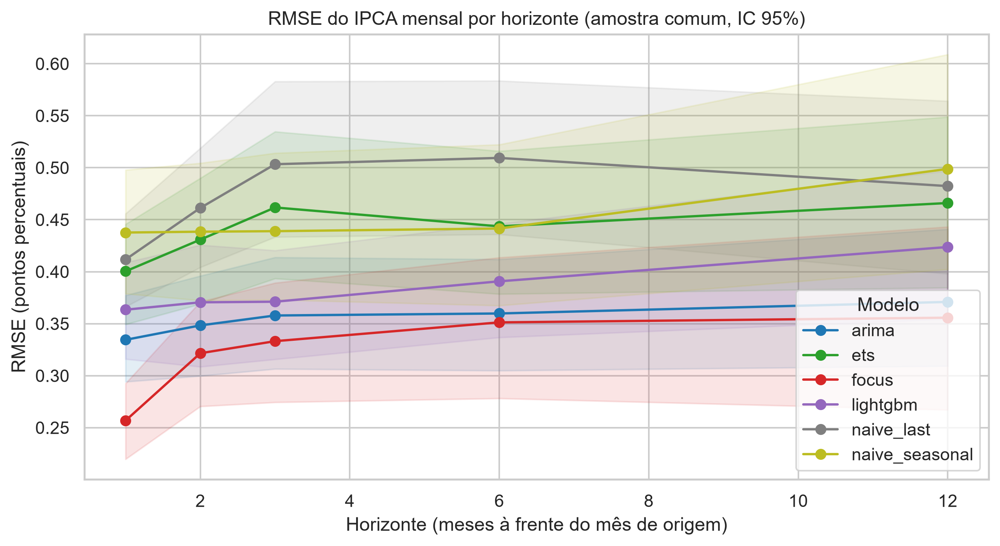

# 📈 Previsão do IPCA com backtest walk-forward

[](https://github.com/luanfreitas5/previsao-ipca-backtest/actions/workflows/ci.yml)
[](https://github.com/luanfreitas5/previsao-ipca-backtest/actions/workflows/tests.yml)
[](https://luanfreitas5.github.io/previsao-ipca-backtest/)
[](pyproject.toml)
[](LICENSE)

Previsão do **IPCA mensal** com backtest **walk-forward sem vazamento temporal**, comparada
ao **Boletim Focus** do Banco Central, com testes estatísticos, intervalos conformais e
rastreamento de experimentos.

> **Resultado:** nenhum modelo superou o Focus. No horizonte de 1 mês o Focus tem RMSE 0,257
> (IC 95%: 0,220–0,293) contra 0,334 do melhor modelo (AutoARIMA) e 0,412 do ingênuo
> (Diebold-Mariano p < 0,001). Em 6 e 12 meses o AutoARIMA empata estatisticamente com o Focus.

## 🎯 Problema

Avaliar modelos de previsão de inflação costuma ser enganoso: usar séries na versão final
(ignorando a data de divulgação), treinar com alvos ainda desconhecidos ou comparar modelos em
amostras diferentes produz erros artificialmente baixos. Este projeto trata o vazamento temporal
como requisito de projeto, com testes automatizados que o verificam.

## ❓ Pergunta

> Algum modelo estatístico ou de machine learning, usando apenas informação **publicamente
> disponível na data da previsão**, consegue superar de forma estatisticamente significativa a
> mediana do Focus na previsão do IPCA mensal — e em quais horizontes e períodos ele perde?

## 🗂️ Dados

| Fonte | Série | Código SGS | Uso | Atraso de divulgação assumido |
|---|---|---|---|---|
| BCB/SGS | IPCA, variação mensal (%) | 433 | alvo e lags | 10 dias após o fim do mês |
| BCB/SGS | IGP-M, variação mensal (%) | 189 | feature | 0 dia |
| BCB/SGS | Meta Selic (% a.a.) | 432 | feature (último valor do mês) | 0 dia |
| BCB/SGS | Dólar comercial (R$/US$) | 1 | feature (variação % da média mensal) | 0 dia |
| BCB/SGS | IBC-Br dessazonalizado | 24364 | feature (variação % mensal) | 50 dias |
| BCB/Olinda | Expectativas Focus (IPCA mensal) | — | baseline | snapshot + 3 dias |

Os dados brutos **não ficam no Git**: o `make ingest` baixa e guarda snapshots datados e
imutáveis em `data/bronze/<fonte>/<AAAA-MM-DD>/` com manifesto SHA-256. Rodar de novo no mesmo
dia usa o cache local (idempotente). Os atrasos de divulgação ficam em
[`configs/series.yaml`](configs/series.yaml).

Camadas: `bronze` (como recebido) → `silver` (tipado, deduplicado, validado com pandera) →
`gold` (ledger point-in-time, tabela supervisionada e previsões).

## 🧪 Método

1. **Features point-in-time.** Na origem `o` (fim de mês), só entram observações com
   `available_at <= o`. Testes ([`tests/test_leakage.py`](tests/test_leakage.py)) alteram os
   valores futuros e exigem que as features não mudem.
2. **Modelos.** Ingênuo (último valor e sazonal), AutoARIMA e AutoETS (statsforecast) e
   LightGBM direto (um modelo por horizonte) com 12 lags de cada série.
3. **Backtest.** Janela expansiva, reajuste a cada origem, horizontes 1, 2, 3, 6 e 12 meses.
   O treino só usa linhas cujo **alvo já havia sido divulgado**; `assert_no_leakage` barra o
   contexto que violar isso.
4. **Avaliação.** MAE e RMSE por horizonte na amostra comum, IC de 95% por bootstrap em blocos,
   fatias por subperíodo, piores erros e teste de **Diebold-Mariano** (correção HLN) contra o Focus.
5. **Incerteza.** Intervalos conformais de 90% calibrados só com erros já observáveis.
6. **Experimentos.** MLflow: run pai com configuração, SHA do git e hashes dos dados; run filho por modelo.

## 🔁 Como reproduzir

Requisitos: Python 3.10+ e [uv](https://docs.astral.sh/uv/).

```bash
make init        # instala dependências e hooks do pre-commit
make ingest      # baixa SGS + Focus para data/bronze (idempotente)
make silver      # bronze -> silver
make gold        # ledger point-in-time + tabela supervisionada
make backtest    # walk-forward + conformal + MLflow
make report      # tabelas, figuras e reports/relatorio_final.md
# ou tudo de uma vez:
make pipeline
make mlflow      # interface do MLflow em http://localhost:5000
```

Qualidade e testes: `make test` (testes), `make quality` (ruff, basedpyright, bandit, vulture,
xenon, interrogate, refurb) e `make check` (tudo, espelhando o CI).

## 📊 Resultados

Protocolo: origens mensais de jan/2010 em diante, janela expansiva, reajuste a cada origem,
amostra comum a todos os modelos e ao Focus (n = 200 origens em h=1; 189 em h=12). RMSE em
pontos percentuais do IPCA mensal, com IC de 95% por bootstrap em blocos. Os números abaixo vêm de
[`reports/relatorio_final.md`](reports/relatorio_final.md) (versão 0.1.0) e dependem da data da
coleta, pois o Focus e o IPCA são atualizados todo mês.

### RMSE por horizonte

| Modelo | h=1 | h=2 | h=3 | h=6 | h=12 |
|---|---|---|---|---|---|
| **Focus** (referência) | **0,257** [0,220–0,293] | **0,322** [0,270–0,371] | **0,333** [0,274–0,389] | **0,351** [0,278–0,414] | **0,356** [0,267–0,443] |
| AutoARIMA | 0,334 (×1,30) | 0,348 (×1,08) | 0,358 (×1,07) | 0,360 (×1,02) | 0,371 (×1,04) |
| LightGBM | 0,363 (×1,42) | 0,371 (×1,15) | 0,371 (×1,11) | 0,391 (×1,11) | 0,424 (×1,19) |
| AutoETS | 0,400 (×1,56) | 0,431 (×1,34) | 0,462 (×1,39) | 0,444 (×1,26) | 0,466 (×1,31) |
| Ingênuo (último valor) | 0,412 (×1,60) | 0,461 (×1,43) | 0,503 (×1,51) | 0,509 (×1,45) | 0,482 (×1,36) |
| Ingênuo sazonal | 0,438 (×1,70) | 0,438 (×1,36) | 0,439 (×1,32) | 0,442 (×1,26) | 0,499 (×1,40) |

Entre parênteses, a razão do RMSE ao do Focus (> 1 = pior). IC dos demais modelos no relatório.

### Principais achados

- **O Focus vence em todos os horizontes.** Em h=1 a diferença é significativa para todos os
  modelos (Diebold-Mariano com correção HLN, p < 0,001). O Focus incorpora informação que as séries
  públicas usadas aqui não capturam.
- **O AutoARIMA é o melhor modelo e a vantagem do Focus encolhe com o horizonte:** a razão cai de
  1,30 (h=1) para 1,02–1,07 (h=3–12), e a diferença deixa de ser significativa em h=6 e h=12
  (p = 0,65 e 0,44 na perda quadrática; 0,27 e 0,22 na absoluta). Em h=2 e h=3 o resultado
  depende da perda (quadrática: p = 0,06 e 0,10; absoluta: p = 0,023 em ambos). Ausência de
  significância com pontos autocorrelacionados não prova equivalência.
- **LightGBM, AutoETS e os ingênuos perdem de forma significativa em todos os horizontes**
  (LightGBM: p entre 0,010 e 0,038 em h≥2). O LightGBM não supera o AutoARIMA, apesar das
  features adicionais (IGP-M, Selic, câmbio, IBC-Br).
- **Choque de 2020–2022:** é o período de maior erro para todos. Nos horizontes
  de 2 a 12 meses, o AutoARIMA tem RMSE menor que o do Focus nesse período (ex.: h=6, 0,543
  contra 0,585), e o LightGBM também em h=3 e h=6. Em h=1 o Focus segue melhor. É uma comparação
  descritiva em 36 origens, sem teste de significância.
- **Maiores erros** do AutoARIMA concentram-se em jul/2022 (deflação de −0,68% após medidas sobre
  combustíveis, previsto ≈ +0,5 a +0,7) e mar/2022 (+1,62%): choques de política e preços
  administrados que nenhum modelo univariado antecipa.
- **Cobertura conformal (nominal 90%) é insuficiente:** 0,77–0,89 observado conforme modelo e
  horizonte (AutoARIMA: 0,84 em h=1 e 0,80 em h=12). Os intervalos subcobrem, o que é consistente com
  a violação da trocabilidade em períodos de choque.

### Artefatos

- [`reports/relatorio_final.md`](reports/relatorio_final.md) — tabelas completas, testes de
  Diebold-Mariano (perda quadrática e absoluta), fatias por subperíodo e **“Onde os modelos perdem
  para o Focus”**;
- [`reports/figures/`](reports/figures/) — RMSE por horizonte, previsto vs. realizado (h=1 e
  h=12) e cobertura conformal;
- [`reports/tables/`](reports/tables/) — as mesmas tabelas em CSV.



## ⚠️ Limitações

- **Vintages.** O SGS expõe a revisão mais recente das séries, não a versão que existia em cada
  data. O IPCA quase não é revisado, mas o IBC-Br dessazonalizado é; isso pode tornar o IBC-Br
  levemente otimista.
- **Calendário de divulgação.** Os atrasos são aproximações conservadoras (constantes), não o
  calendário real de cada mês.
- **Amostra curta.** ~190–200 origens por horizonte, mas com erros fortemente autocorrelacionados
  (janelas sobrepostas), então a informação independente é bem menor; as fatias por subperíodo têm
  36–71 origens. Leia sempre os ICs e os p-valores.
- **Conformal.** A cobertura nominal assume resíduos trocáveis; choques (2020–2022) a violam.
- **Focus.** Usa-se a mediana com `baseCalculo = 0` (últimos 30 dias); outras estatísticas
  ou janelas podem mudar o resultado.
- **Sem ajuste fino de hiperparâmetros**, por escolha, para não otimizar sobre o período de teste.

## 🧱 Estrutura

```
configs/      YAML validados com Pydantic (séries, atrasos, modelos, caminhos)
data/         bronze (imutável) | silver (limpo) | gold (modelagem) — fora do Git
src/          config, data, features, models, backtest, reporting, experiment, schemas, ...
tests/        unitários, property-based (hypothesis) e testes de vazamento
notebooks/    EDA (01_eda.ipynb)
reports/      relatório final, figuras e tabelas
docs/         MkDocs Material + mkdocstrings
```

## 📄 Licença

[MIT](LICENSE)
