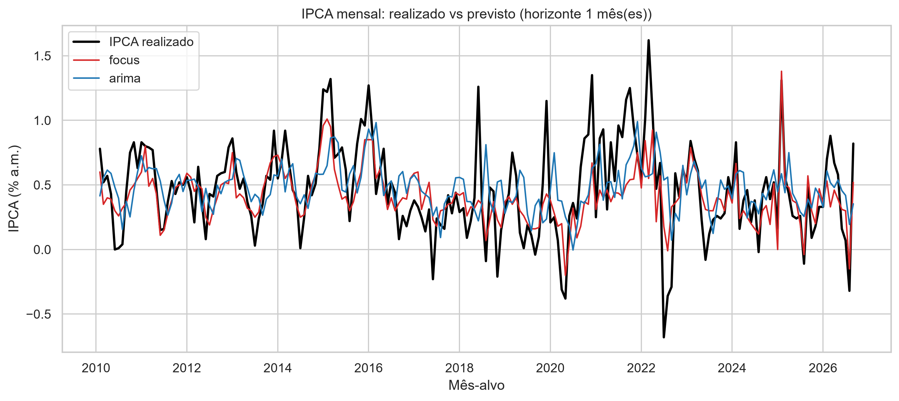
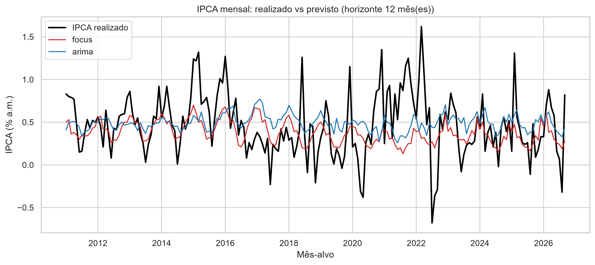
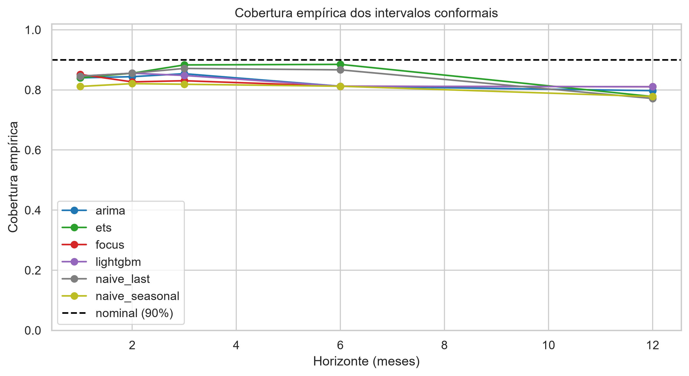

# Relatório final — Previsão do IPCA mensal (backtest walk-forward)

_Versão 0.1.0. Gerado automaticamente por `python src/main.py report`._

## 1. Desenho do experimento

- Origens: fins de mês de 2010-01-31 em diante, janela expansiva.
- Horizontes: [1, 2, 3, 6, 12] meses à frente do mês de origem.
- Referência: **focus** (mediana do Boletim Focus vigente na origem).
- Todas as métricas usam a amostra comum a todos os modelos e ao Focus.

## 2. Erro por horizonte (IC 95% por bootstrap em blocos)

| model | horizon | n | mae | rmse | rmse_lo | rmse_hi | rmse_ratio |
| --- | --- | --- | --- | --- | --- | --- | --- |
| arima | 1 | 200 | 0.255 | 0.334 | 0.294 | 0.377 | 1.302 |
| ets | 1 | 200 | 0.306 | 0.400 | 0.349 | 0.446 | 1.559 |
| focus | 1 | 200 | 0.187 | 0.257 | 0.220 | 0.293 | 1.000 |
| lightgbm | 1 | 200 | 0.268 | 0.363 | 0.316 | 0.409 | 1.415 |
| naive_last | 1 | 200 | 0.318 | 0.412 | 0.366 | 0.456 | 1.603 |
| naive_seasonal | 1 | 200 | 0.324 | 0.438 | 0.379 | 0.498 | 1.704 |
| arima | 2 | 199 | 0.261 | 0.348 | 0.300 | 0.396 | 1.083 |
| ets | 2 | 199 | 0.329 | 0.431 | 0.369 | 0.490 | 1.340 |
| focus | 2 | 199 | 0.232 | 0.322 | 0.270 | 0.371 | 1.000 |
| lightgbm | 2 | 199 | 0.271 | 0.371 | 0.309 | 0.426 | 1.152 |
| naive_last | 2 | 199 | 0.358 | 0.461 | 0.404 | 0.519 | 1.435 |
| naive_seasonal | 2 | 199 | 0.325 | 0.438 | 0.372 | 0.504 | 1.363 |
| arima | 3 | 198 | 0.273 | 0.358 | 0.306 | 0.414 | 1.074 |
| ets | 3 | 198 | 0.342 | 0.462 | 0.393 | 0.535 | 1.386 |
| focus | 3 | 198 | 0.245 | 0.333 | 0.274 | 0.389 | 1.000 |
| lightgbm | 3 | 198 | 0.280 | 0.371 | 0.316 | 0.420 | 1.114 |
| naive_last | 3 | 198 | 0.385 | 0.503 | 0.433 | 0.583 | 1.511 |
| naive_seasonal | 3 | 198 | 0.325 | 0.439 | 0.373 | 0.514 | 1.318 |
| arima | 6 | 195 | 0.278 | 0.360 | 0.305 | 0.412 | 1.024 |
| ets | 6 | 195 | 0.338 | 0.444 | 0.379 | 0.516 | 1.263 |
| focus | 6 | 195 | 0.260 | 0.351 | 0.278 | 0.414 | 1.000 |
| lightgbm | 6 | 195 | 0.305 | 0.391 | 0.337 | 0.446 | 1.112 |
| naive_last | 6 | 195 | 0.390 | 0.509 | 0.436 | 0.584 | 1.450 |
| naive_seasonal | 6 | 195 | 0.327 | 0.442 | 0.367 | 0.522 | 1.257 |
| arima | 12 | 189 | 0.287 | 0.371 | 0.309 | 0.441 | 1.043 |
| ets | 12 | 189 | 0.361 | 0.466 | 0.385 | 0.549 | 1.310 |
| focus | 12 | 189 | 0.265 | 0.356 | 0.267 | 0.443 | 1.000 |
| lightgbm | 12 | 189 | 0.340 | 0.424 | 0.354 | 0.497 | 1.191 |
| naive_last | 12 | 189 | 0.378 | 0.482 | 0.398 | 0.564 | 1.356 |
| naive_seasonal | 12 | 189 | 0.382 | 0.499 | 0.402 | 0.609 | 1.402 |

`rmse_ratio` > 1 significa pior que o Focus.

## 3. Diebold-Mariano contra o Focus (perda quadrática)

Estatística < 0: modelo mais acurado que o Focus. Correção HLN, cauda t.

| model | horizon | loss | n | mean_diff | dm_stat | p_value |
| --- | --- | --- | --- | --- | --- | --- |
| arima | 1 | squared | 200 | 0.046 | 4.919 | 0.000 |
| ets | 1 | squared | 200 | 0.094 | 5.704 | 0.000 |
| lightgbm | 1 | squared | 200 | 0.066 | 5.551 | 0.000 |
| naive_last | 1 | squared | 200 | 0.104 | 6.066 | 0.000 |
| naive_seasonal | 1 | squared | 200 | 0.126 | 5.720 | 0.000 |
| arima | 2 | squared | 199 | 0.018 | 1.876 | 0.062 |
| ets | 2 | squared | 199 | 0.082 | 3.664 | 0.000 |
| lightgbm | 2 | squared | 199 | 0.034 | 2.487 | 0.014 |
| naive_last | 2 | squared | 199 | 0.109 | 4.616 | 0.000 |
| naive_seasonal | 2 | squared | 199 | 0.089 | 3.465 | 0.001 |
| arima | 3 | squared | 198 | 0.017 | 1.637 | 0.103 |
| ets | 3 | squared | 198 | 0.102 | 3.322 | 0.001 |
| lightgbm | 3 | squared | 198 | 0.027 | 2.093 | 0.038 |
| naive_last | 3 | squared | 198 | 0.142 | 4.354 | 0.000 |
| naive_seasonal | 3 | squared | 198 | 0.082 | 2.861 | 0.005 |
| arima | 6 | squared | 195 | 0.006 | 0.449 | 0.654 |
| ets | 6 | squared | 195 | 0.073 | 2.069 | 0.040 |
| lightgbm | 6 | squared | 195 | 0.029 | 2.617 | 0.010 |
| naive_last | 6 | squared | 195 | 0.136 | 3.170 | 0.002 |
| naive_seasonal | 6 | squared | 195 | 0.072 | 2.358 | 0.019 |
| arima | 12 | squared | 189 | 0.011 | 0.781 | 0.436 |
| ets | 12 | squared | 189 | 0.091 | 3.297 | 0.001 |
| lightgbm | 12 | squared | 189 | 0.053 | 2.189 | 0.030 |
| naive_last | 12 | squared | 189 | 0.106 | 3.106 | 0.002 |
| naive_seasonal | 12 | squared | 189 | 0.122 | 2.633 | 0.009 |

### Perda absoluta

| model | horizon | loss | n | mean_diff | dm_stat | p_value |
| --- | --- | --- | --- | --- | --- | --- |
| arima | 1 | absolute | 200 | 0.068 | 5.905 | 0.000 |
| ets | 1 | absolute | 200 | 0.119 | 7.130 | 0.000 |
| lightgbm | 1 | absolute | 200 | 0.081 | 5.888 | 0.000 |
| naive_last | 1 | absolute | 200 | 0.131 | 7.334 | 0.000 |
| naive_seasonal | 1 | absolute | 200 | 0.137 | 8.152 | 0.000 |
| arima | 2 | absolute | 199 | 0.029 | 2.296 | 0.023 |
| ets | 2 | absolute | 199 | 0.097 | 4.483 | 0.000 |
| lightgbm | 2 | absolute | 199 | 0.039 | 2.375 | 0.018 |
| naive_last | 2 | absolute | 199 | 0.126 | 5.504 | 0.000 |
| naive_seasonal | 2 | absolute | 199 | 0.093 | 4.170 | 0.000 |
| arima | 3 | absolute | 198 | 0.028 | 2.293 | 0.023 |
| ets | 3 | absolute | 198 | 0.097 | 4.152 | 0.000 |
| lightgbm | 3 | absolute | 198 | 0.035 | 2.272 | 0.024 |
| naive_last | 3 | absolute | 198 | 0.140 | 5.847 | 0.000 |
| naive_seasonal | 3 | absolute | 198 | 0.080 | 3.416 | 0.001 |
| arima | 6 | absolute | 195 | 0.018 | 1.103 | 0.272 |
| ets | 6 | absolute | 195 | 0.078 | 2.202 | 0.029 |
| lightgbm | 6 | absolute | 195 | 0.044 | 3.379 | 0.001 |
| naive_last | 6 | absolute | 195 | 0.129 | 3.444 | 0.001 |
| naive_seasonal | 6 | absolute | 195 | 0.067 | 2.455 | 0.015 |
| arima | 12 | absolute | 189 | 0.022 | 1.234 | 0.219 |
| ets | 12 | absolute | 189 | 0.096 | 3.404 | 0.001 |
| lightgbm | 12 | absolute | 189 | 0.075 | 2.691 | 0.008 |
| naive_last | 12 | absolute | 189 | 0.112 | 3.500 | 0.001 |
| naive_seasonal | 12 | absolute | 189 | 0.117 | 2.608 | 0.010 |

## 4. Onde os modelos perdem para o Focus

- h=1: **arima** perde significativamente para focus (RMSE 0.334; razão ao focus 1.30; p-valor DM = 0.000)
- h=1: **ets** perde significativamente para focus (RMSE 0.400; razão ao focus 1.56; p-valor DM = 0.000)
- h=1: **lightgbm** perde significativamente para focus (RMSE 0.363; razão ao focus 1.42; p-valor DM = 0.000)
- h=1: **naive_last** perde significativamente para focus (RMSE 0.412; razão ao focus 1.60; p-valor DM = 0.000)
- h=1: **naive_seasonal** perde significativamente para focus (RMSE 0.438; razão ao focus 1.70; p-valor DM = 0.000)
- h=2: **arima** perde (sem significância) para focus (RMSE 0.348; razão ao focus 1.08; p-valor DM = 0.062)
- h=2: **ets** perde significativamente para focus (RMSE 0.431; razão ao focus 1.34; p-valor DM = 0.000)
- h=2: **lightgbm** perde significativamente para focus (RMSE 0.371; razão ao focus 1.15; p-valor DM = 0.014)
- h=2: **naive_last** perde significativamente para focus (RMSE 0.461; razão ao focus 1.43; p-valor DM = 0.000)
- h=2: **naive_seasonal** perde significativamente para focus (RMSE 0.438; razão ao focus 1.36; p-valor DM = 0.001)
- h=3: **arima** perde (sem significância) para focus (RMSE 0.358; razão ao focus 1.07; p-valor DM = 0.103)
- h=3: **ets** perde significativamente para focus (RMSE 0.462; razão ao focus 1.39; p-valor DM = 0.001)
- h=3: **lightgbm** perde significativamente para focus (RMSE 0.371; razão ao focus 1.11; p-valor DM = 0.038)
- h=3: **naive_last** perde significativamente para focus (RMSE 0.503; razão ao focus 1.51; p-valor DM = 0.000)
- h=3: **naive_seasonal** perde significativamente para focus (RMSE 0.439; razão ao focus 1.32; p-valor DM = 0.005)
- h=6: **arima** perde (sem significância) para focus (RMSE 0.360; razão ao focus 1.02; p-valor DM = 0.654)
- h=6: **ets** perde significativamente para focus (RMSE 0.444; razão ao focus 1.26; p-valor DM = 0.040)
- h=6: **lightgbm** perde significativamente para focus (RMSE 0.391; razão ao focus 1.11; p-valor DM = 0.010)
- h=6: **naive_last** perde significativamente para focus (RMSE 0.509; razão ao focus 1.45; p-valor DM = 0.002)
- h=6: **naive_seasonal** perde significativamente para focus (RMSE 0.442; razão ao focus 1.26; p-valor DM = 0.019)
- h=12: **arima** perde (sem significância) para focus (RMSE 0.371; razão ao focus 1.04; p-valor DM = 0.436)
- h=12: **ets** perde significativamente para focus (RMSE 0.466; razão ao focus 1.31; p-valor DM = 0.001)
- h=12: **lightgbm** perde significativamente para focus (RMSE 0.424; razão ao focus 1.19; p-valor DM = 0.030)
- h=12: **naive_last** perde significativamente para focus (RMSE 0.482; razão ao focus 1.36; p-valor DM = 0.002)
- h=12: **naive_seasonal** perde significativamente para focus (RMSE 0.499; razão ao focus 1.40; p-valor DM = 0.009)

## 5. Avaliação por subperíodo

| slice | model | horizon | n | mae | rmse |
| --- | --- | --- | --- | --- | --- |
| 2010-2015 | arima | 1 | 71 | 0.200 | 0.251 |
| 2010-2015 | ets | 1 | 71 | 0.257 | 0.322 |
| 2010-2015 | focus | 1 | 71 | 0.150 | 0.184 |
| 2010-2015 | lightgbm | 1 | 71 | 0.224 | 0.286 |
| 2010-2015 | naive_last | 1 | 71 | 0.260 | 0.324 |
| 2010-2015 | naive_seasonal | 1 | 71 | 0.212 | 0.266 |
| 2010-2015 | arima | 2 | 70 | 0.205 | 0.264 |
| 2010-2015 | ets | 2 | 70 | 0.276 | 0.350 |
| 2010-2015 | focus | 2 | 70 | 0.182 | 0.229 |
| 2010-2015 | lightgbm | 2 | 70 | 0.215 | 0.285 |
| 2010-2015 | naive_last | 2 | 70 | 0.308 | 0.378 |
| 2010-2015 | naive_seasonal | 2 | 70 | 0.212 | 0.266 |
| 2010-2015 | arima | 3 | 69 | 0.216 | 0.275 |
| 2010-2015 | ets | 3 | 69 | 0.290 | 0.382 |
| 2010-2015 | focus | 3 | 69 | 0.188 | 0.238 |
| 2010-2015 | lightgbm | 3 | 69 | 0.224 | 0.290 |
| 2010-2015 | naive_last | 3 | 69 | 0.351 | 0.424 |
| 2010-2015 | naive_seasonal | 3 | 69 | 0.210 | 0.265 |
| 2010-2015 | arima | 6 | 66 | 0.215 | 0.277 |
| 2010-2015 | ets | 6 | 66 | 0.314 | 0.395 |
| 2010-2015 | focus | 6 | 66 | 0.195 | 0.251 |
| 2010-2015 | lightgbm | 6 | 66 | 0.241 | 0.303 |
| 2010-2015 | naive_last | 6 | 66 | 0.385 | 0.476 |
| 2010-2015 | naive_seasonal | 6 | 66 | 0.212 | 0.267 |
| 2010-2015 | arima | 12 | 60 | 0.203 | 0.271 |
| 2010-2015 | ets | 12 | 60 | 0.242 | 0.301 |
| 2010-2015 | focus | 12 | 60 | 0.196 | 0.255 |
| 2010-2015 | lightgbm | 12 | 60 | 0.247 | 0.294 |
| 2010-2015 | naive_last | 12 | 60 | 0.237 | 0.287 |
| 2010-2015 | naive_seasonal | 12 | 60 | 0.232 | 0.297 |
| 2016-2019 | arima | 1 | 48 | 0.273 | 0.363 |
| 2016-2019 | ets | 1 | 48 | 0.275 | 0.402 |
| 2016-2019 | focus | 1 | 48 | 0.182 | 0.251 |
| 2016-2019 | lightgbm | 1 | 48 | 0.262 | 0.340 |
| 2016-2019 | naive_last | 1 | 48 | 0.303 | 0.422 |
| 2016-2019 | naive_seasonal | 1 | 48 | 0.372 | 0.498 |
| 2016-2019 | arima | 2 | 48 | 0.273 | 0.343 |
| 2016-2019 | ets | 2 | 48 | 0.288 | 0.391 |
| 2016-2019 | focus | 2 | 48 | 0.208 | 0.283 |
| 2016-2019 | lightgbm | 2 | 48 | 0.263 | 0.347 |
| 2016-2019 | naive_last | 2 | 48 | 0.296 | 0.400 |
| 2016-2019 | naive_seasonal | 2 | 48 | 0.372 | 0.498 |
| 2016-2019 | arima | 3 | 48 | 0.296 | 0.353 |
| 2016-2019 | ets | 3 | 48 | 0.314 | 0.424 |
| 2016-2019 | focus | 3 | 48 | 0.222 | 0.292 |
| 2016-2019 | lightgbm | 3 | 48 | 0.280 | 0.362 |
| 2016-2019 | naive_last | 3 | 48 | 0.321 | 0.419 |
| 2016-2019 | naive_seasonal | 3 | 48 | 0.372 | 0.498 |
| 2016-2019 | arima | 6 | 48 | 0.304 | 0.361 |
| 2016-2019 | ets | 6 | 48 | 0.295 | 0.395 |
| 2016-2019 | focus | 6 | 48 | 0.236 | 0.308 |
| 2016-2019 | lightgbm | 6 | 48 | 0.342 | 0.416 |
| 2016-2019 | naive_last | 6 | 48 | 0.315 | 0.420 |
| 2016-2019 | naive_seasonal | 6 | 48 | 0.372 | 0.498 |
| 2016-2019 | arima | 12 | 48 | 0.317 | 0.373 |
| 2016-2019 | ets | 12 | 48 | 0.382 | 0.479 |
| 2016-2019 | focus | 12 | 48 | 0.253 | 0.319 |
| 2016-2019 | lightgbm | 12 | 48 | 0.402 | 0.470 |
| 2016-2019 | naive_last | 12 | 48 | 0.389 | 0.496 |
| 2016-2019 | naive_seasonal | 12 | 48 | 0.413 | 0.495 |
| 2020-2022 (pandemia e choque) | arima | 1 | 36 | 0.400 | 0.484 |
| 2020-2022 (pandemia e choque) | ets | 1 | 36 | 0.490 | 0.581 |
| 2020-2022 (pandemia e choque) | focus | 1 | 36 | 0.331 | 0.423 |
| 2020-2022 (pandemia e choque) | lightgbm | 1 | 36 | 0.428 | 0.556 |
| 2020-2022 (pandemia e choque) | naive_last | 1 | 36 | 0.483 | 0.577 |
| 2020-2022 (pandemia e choque) | naive_seasonal | 1 | 36 | 0.538 | 0.663 |
| 2020-2022 (pandemia e choque) | arima | 2 | 36 | 0.423 | 0.533 |
| 2020-2022 (pandemia e choque) | ets | 2 | 36 | 0.545 | 0.654 |
| 2020-2022 (pandemia e choque) | focus | 2 | 36 | 0.449 | 0.553 |
| 2020-2022 (pandemia e choque) | lightgbm | 2 | 36 | 0.432 | 0.567 |
| 2020-2022 (pandemia e choque) | naive_last | 2 | 36 | 0.559 | 0.674 |
| 2020-2022 (pandemia e choque) | naive_seasonal | 2 | 36 | 0.538 | 0.663 |
| 2020-2022 (pandemia e choque) | arima | 3 | 36 | 0.423 | 0.549 |
| 2020-2022 (pandemia e choque) | ets | 3 | 36 | 0.528 | 0.692 |
| 2020-2022 (pandemia e choque) | focus | 3 | 36 | 0.457 | 0.564 |
| 2020-2022 (pandemia e choque) | lightgbm | 3 | 36 | 0.452 | 0.556 |
| 2020-2022 (pandemia e choque) | naive_last | 3 | 36 | 0.557 | 0.743 |
| 2020-2022 (pandemia e choque) | naive_seasonal | 3 | 36 | 0.538 | 0.663 |
| 2020-2022 (pandemia e choque) | arima | 6 | 36 | 0.440 | 0.543 |
| 2020-2022 (pandemia e choque) | ets | 6 | 36 | 0.454 | 0.590 |
| 2020-2022 (pandemia e choque) | focus | 6 | 36 | 0.487 | 0.585 |
| 2020-2022 (pandemia e choque) | lightgbm | 6 | 36 | 0.452 | 0.564 |
| 2020-2022 (pandemia e choque) | naive_last | 6 | 36 | 0.498 | 0.659 |
| 2020-2022 (pandemia e choque) | naive_seasonal | 6 | 36 | 0.538 | 0.663 |
| 2020-2022 (pandemia e choque) | arima | 12 | 36 | 0.457 | 0.558 |
| 2020-2022 (pandemia e choque) | ets | 12 | 36 | 0.583 | 0.696 |
| 2020-2022 (pandemia e choque) | focus | 12 | 36 | 0.480 | 0.580 |
| 2020-2022 (pandemia e choque) | lightgbm | 12 | 36 | 0.495 | 0.612 |
| 2020-2022 (pandemia e choque) | naive_last | 12 | 36 | 0.606 | 0.711 |
| 2020-2022 (pandemia e choque) | naive_seasonal | 12 | 36 | 0.609 | 0.730 |
| 2023+ | arima | 1 | 45 | 0.208 | 0.264 |
| 2023+ | ets | 1 | 45 | 0.271 | 0.327 |
| 2023+ | focus | 1 | 45 | 0.135 | 0.170 |
| 2023+ | lightgbm | 1 | 45 | 0.217 | 0.295 |
| 2023+ | naive_last | 1 | 45 | 0.294 | 0.363 |
| 2023+ | naive_seasonal | 1 | 45 | 0.280 | 0.352 |
| 2023+ | arima | 2 | 45 | 0.207 | 0.275 |
| 2023+ | ets | 2 | 45 | 0.284 | 0.353 |
| 2023+ | focus | 2 | 45 | 0.163 | 0.214 |
| 2023+ | lightgbm | 2 | 45 | 0.237 | 0.308 |
| 2023+ | naive_last | 2 | 45 | 0.342 | 0.430 |
| 2023+ | naive_seasonal | 2 | 45 | 0.280 | 0.352 |
| 2023+ | arima | 3 | 45 | 0.215 | 0.271 |
| 2023+ | ets | 3 | 45 | 0.301 | 0.375 |
| 2023+ | focus | 3 | 45 | 0.187 | 0.237 |
| 2023+ | lightgbm | 3 | 45 | 0.228 | 0.300 |
| 2023+ | naive_last | 3 | 45 | 0.366 | 0.458 |
| 2023+ | naive_seasonal | 3 | 45 | 0.280 | 0.352 |
| 2023+ | arima | 6 | 45 | 0.215 | 0.272 |
| 2023+ | ets | 6 | 45 | 0.326 | 0.423 |
| 2023+ | focus | 6 | 45 | 0.200 | 0.260 |
| 2023+ | lightgbm | 6 | 45 | 0.240 | 0.296 |
| 2023+ | naive_last | 6 | 45 | 0.391 | 0.506 |
| 2023+ | naive_seasonal | 6 | 45 | 0.280 | 0.352 |
| 2023+ | arima | 12 | 45 | 0.229 | 0.287 |
| 2023+ | ets | 12 | 45 | 0.320 | 0.399 |
| 2023+ | focus | 12 | 45 | 0.199 | 0.260 |
| 2023+ | lightgbm | 12 | 45 | 0.275 | 0.322 |
| 2023+ | naive_last | 12 | 45 | 0.370 | 0.448 |
| 2023+ | naive_seasonal | 12 | 45 | 0.368 | 0.489 |

## 6. Intervalos conformais

Cobertura nominal: 90%. Calibração apenas com erros já divulgados na origem.

| model | horizon | n | coverage | mean_width |
| --- | --- | --- | --- | --- |
| arima | 1 | 175 | 0.840 | 0.952 |
| ets | 1 | 175 | 0.840 | 1.174 |
| focus | 1 | 175 | 0.851 | 0.719 |
| lightgbm | 1 | 175 | 0.846 | 1.051 |
| naive_last | 1 | 175 | 0.846 | 1.202 |
| naive_seasonal | 1 | 175 | 0.811 | 1.159 |
| arima | 2 | 173 | 0.844 | 1.015 |
| ets | 2 | 173 | 0.855 | 1.303 |
| focus | 2 | 173 | 0.827 | 0.882 |
| lightgbm | 2 | 173 | 0.855 | 1.034 |
| naive_last | 2 | 173 | 0.855 | 1.342 |
| naive_seasonal | 2 | 173 | 0.821 | 1.165 |
| arima | 3 | 171 | 0.854 | 1.050 |
| ets | 3 | 171 | 0.883 | 1.409 |
| focus | 3 | 171 | 0.830 | 0.930 |
| lightgbm | 3 | 171 | 0.848 | 1.154 |
| naive_last | 3 | 171 | 0.871 | 1.498 |
| naive_seasonal | 3 | 171 | 0.819 | 1.170 |
| arima | 6 | 165 | 0.812 | 1.014 |
| ets | 6 | 165 | 0.885 | 1.341 |
| focus | 6 | 165 | 0.812 | 0.996 |
| lightgbm | 6 | 165 | 0.812 | 1.118 |
| naive_last | 6 | 165 | 0.867 | 1.642 |
| naive_seasonal | 6 | 165 | 0.812 | 1.183 |
| arima | 12 | 153 | 0.797 | 1.043 |
| ets | 12 | 153 | 0.778 | 1.340 |
| focus | 12 | 153 | 0.810 | 0.992 |
| lightgbm | 12 | 153 | 0.810 | 1.243 |
| naive_last | 12 | 153 | 0.771 | 1.349 |
| naive_seasonal | 12 | 153 | 0.778 | 1.365 |

## 7. Maiores erros do melhor modelo (`arima`)

| origin | horizon | target_period | y_true | y_pred | error |
| --- | --- | --- | --- | --- | --- |
| 2022-04-30 | 3 | 2022-07-01 | -0.680 | 0.727 | 1.407 |
| 2022-05-31 | 2 | 2022-07-01 | -0.680 | 0.717 | 1.397 |
| 2022-06-30 | 1 | 2022-07-01 | -0.680 | 0.538 | 1.218 |
| 2022-01-31 | 6 | 2022-07-01 | -0.680 | 0.523 | 1.203 |
| 2021-03-31 | 12 | 2022-03-01 | 1.620 | 0.491 | -1.129 |
| 2021-07-31 | 12 | 2022-07-01 | -0.680 | 0.438 | 1.118 |
| 2022-01-31 | 2 | 2022-03-01 | 1.620 | 0.548 | -1.072 |
| 2021-09-30 | 6 | 2022-03-01 | 1.620 | 0.552 | -1.068 |
| 2018-04-30 | 2 | 2018-06-01 | 1.260 | 0.209 | -1.051 |
| 2022-02-28 | 1 | 2022-03-01 | 1.620 | 0.569 | -1.051 |

## 8. Figuras

## 9. Limitações

- O IBC-Br e as demais séries estão na revisão mais recente do SGS, não na vintage original de cada data (não há vintages em tempo real no SGS).
- As defasagens de divulgação são aproximações conservadoras do calendário real.
- Intervalos conformais assumem resíduos aproximadamente trocáveis.
- Amostra curta: poucas dezenas de pontos por horizonte; veja os ICs.
